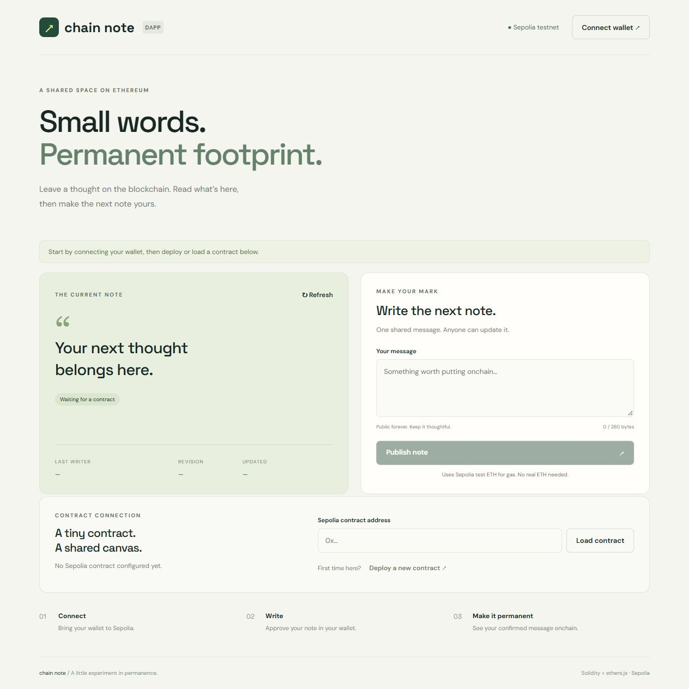
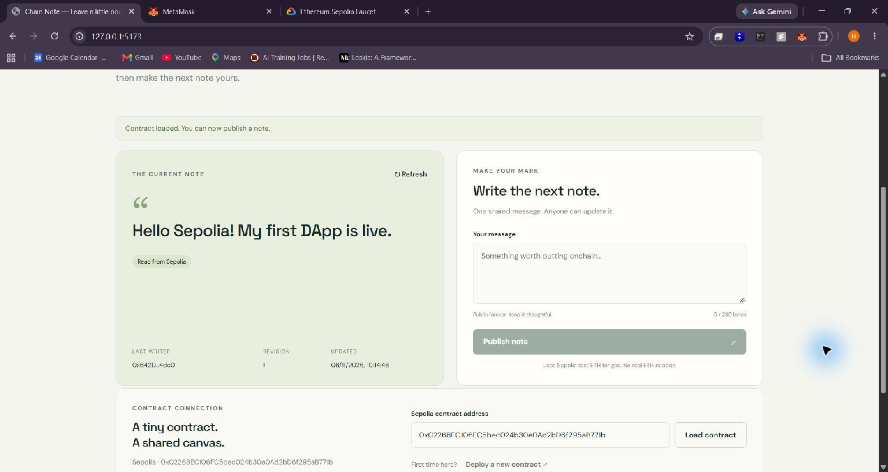

# Chain Note

A simple decentralized message board built with Solidity, vanilla JavaScript, Vite and ethers.js v6. Anyone can read the current message and use a wallet to replace it on Ethereum Sepolia.

## Features

- Connect MetaMask or another injected Ethereum wallet.
- Switch to Sepolia, with an add-network fallback.
- Deploy the included contract directly from the UI; no private key files required.
- Call `setMessage(string)` and display the result of `getNote()`.
- Display the last writer, revision and block timestamp.
- Track pending and confirmed transactions with Etherscan links.
- Validate messages as 1–280 UTF-8 bytes, including emoji.
- Responsive UI, accessible labels and live status messages.

## Deployment

<!-- deployment:start -->
- Test network: **Ethereum Sepolia**
- Chain ID: **11155111**
- Contract address: [`0x02268EC106FC5bec024b30e0Ad2bD6f295aB771b`](https://sepolia.etherscan.io/address/0x02268EC106FC5bec024b30e0Ad2bD6f295aB771b)
- Deployment transaction: [`0x4a619e47a58c136d21c399ed1b2762b094c5e79baaec60cbb7296a35012c22d8`](https://sepolia.etherscan.io/tx/0x4a619e47a58c136d21c399ed1b2762b094c5e79baaec60cbb7296a35012c22d8)
<!-- deployment:end -->

The deployment above was verified against its successful Sepolia receipt and this project’s compiled creation bytecode.

## Run the frontend

Prerequisites: Node.js 22.12+ or 24, npm, MetaMask, and Sepolia test ETH for transactions.

```sh
npm ci
npm run dev
```

Open the local URL printed by Vite (normally http://127.0.0.1:5173) in the browser where MetaMask is installed. The compile step generates the ABI and deployment bytecode from the Solidity source. No backend, secret key or paid RPC provider is needed.

## Deploy the smart contract

1. Start the frontend as described above.
2. Enable test networks in MetaMask and fund your account with Sepolia test ETH. See [Ethereum test networks](https://ethereum.org/en/developers/docs/networks/) for testnet information and faucet links.
3. Click **Connect wallet** and accept the connection and Sepolia network switch.
4. Click **Deploy a new contract** in the Contract connection section.
5. Review and approve the contract creation transaction in MetaMask. Confirm that the network is Sepolia.
6. Wait for the app to report a confirmed deployment. The new address is loaded automatically.
7. Enter a message, select **Publish note**, approve the transaction, and wait for confirmation. The current note and revision update from the contract.
8. Click **Download deployment record**. Save the JSON file, then run:

```sh
npm run record-deployment -- /path/to/sepolia-deployment.json
```

This command verifies the receipt, address, deployed bytecode and contract read on Sepolia before updating `src/deployment.json` and the deployment section above. Commit both files to GitHub. Subsequent visitors get this address prefilled. You can also load an existing deployment by pasting its address.

## Screenshot



The overview above shows the frontend layout. The connected screenshot below shows the deployed contract after a successful write on Sepolia.



Verified demonstration transaction: [publish first note](https://sepolia.etherscan.io/tx/0x034eb6d80012379cdec3a2d7fe03138606f09dc1e261f41d1ea6b22e37e592dd). The contract returned revision 1 and the message “Hello Sepolia! My first DApp is live.” See `docs/onchain-verification.json` for the recorded result.

## Build and tests

```sh
npm test
npm run build
```

The contract test uses an ephemeral local Ganache chain, deploys the actual compiled Solidity contract, checks default state, writes from another account, verifies the event and metadata, rejects empty/oversized messages and checks ASCII/emoji boundary lengths. This local test does not claim a Sepolia deployment. GitHub Actions runs the contract test and frontend build.

`npm run build` produces static files in `dist/`, suitable for a static web host.

## Project structure

- `contracts/ChainNote.sol` — Solidity contract.
- `src/main.js` — wallet connection and ethers.js contract calls.
- `src/style.css` — responsive interface.
- `src/contract.json` — generated ABI and bytecode.
- `src/deployment.json` — shared Sepolia deployment record.
- `scripts/compile.mjs` — reproducible Solidity compilation.
- `scripts/record-deployment.mjs` — verified deployment registration.
- `tests/contract.test.mjs` — real EVM integration test.
- `docs/ui.png` — UI screenshot.

## Design and limitations

This is intentionally a public shared board: any account can overwrite the current message, and the last confirmed write wins. Older writes remain in transaction history and `MessageUpdated` events. Messages are public; do not publish personal information or secrets. The contract takes no payments and has no admin role. Sepolia test ETH is only used for network gas. The UI stores a selected contract address locally for convenience; message data comes from the blockchain. A compatible injected wallet is required to connect and read in this minimal version. Refresh retrieves updates made by other users.

## References

- [ethers.js contract API](https://docs.ethers.org/v6/api/contract/)
- [Ethereum networks](https://ethereum.org/en/developers/docs/networks/)
- [Solidity documentation](https://docs.soliditylang.org/)

### Test tooling note

Ganache is used only as an in-process, disposable test chain with generated test accounts. Its bundled dependencies have published audit advisories; do not expose it as a public service or import real wallet keys into it. Ganache is not imported into the browser bundle. Node.js 24 may print a native-module warning before falling back to its JavaScript implementation; the contract test still runs.
